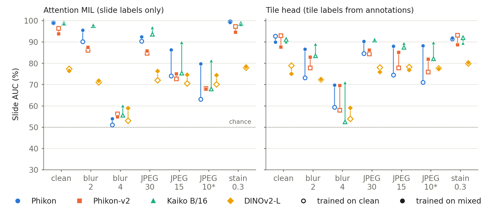

# Is it the encoder or the head?

Slide-level robustness of pathology foundation models to acquisition artifacts, on lymph-node
metastasis detection in CAMELYON16.

[](https://doi.org/10.5281/zenodo.23323558)

**Report:** [doi:10.5281/zenodo.23323558](https://doi.org/10.5281/zenodo.23323558) (technical report, version 1, 12 October 2026; also in [`paper/camelyon_slide_report.pdf`](paper/camelyon_slide_report.pdf))

Follow-up to [encoder-or-probe](https://github.com/dinakar0745/encoder-or-probe)
([report](https://doi.org/10.5281/zenodo.23162508)), which found at patch level that much of
the accuracy a frozen pathology encoder loses under image degradation belongs to the linear
probe, not the encoder. This repository asks the same question when the head is a slide-level
aggregator over thousands of frozen tile embeddings.

**Short answer:** for compression, mostly the head again, but supervision matters. Training an
attention head on a mix of clean and degraded tiles recovers much of the slide AUC lost to
JPEG for Phikon and Kaiko B/16, at no cost on clean slides; it does not help Phikon-v2. The
tumour signal is still in the embeddings: tile-level probes separate tumour under every
degradation tested, and a head given tile labels recovers where the attention head does not.
Pooled AUC hides the clinical cost: at 95% specificity the loss falls on small metastases, and
under heavy blur slide scores mostly track which hospital a slide came from.



## Main results

Slide AUC in %, all 129 test slides, mean of five seeds, head trained on clean embeddings ->
head trained on mixed embeddings. JPEG quality 10 was never seen in training.

| Head | Condition | Phikon | Kaiko B/16 | Phikon-v2 | DINOv2-L |
| --- | --- | --- | --- | --- | --- |
| Attention MIL | Clean | 98.9 -> 98.8 | 98.6 -> 98.5 | 96.4 -> 93.8 | 77.3 -> 76.4 |
| Attention MIL | JPEG Q15 | 74.0 -> 86.2 | 75.3 -> 89.7 | 72.7 -> 75.0 | 70.5 -> 74.6 |
| Attention MIL | JPEG Q10 | 63.1 -> 79.7 | 67.9 -> 81.1 | 68.1 -> 67.8 | 70.0 -> 74.4 |
| Attention MIL | Blur sigma 4 | 51.0 -> 53.9 | 55.6 -> 60.0 | 56.2 -> 54.8 | 53.0 -> 58.9 |
| Tile head | JPEG Q10 | 71.0 -> 88.2 | 82.1 -> 89.6 | 75.8 -> 81.9 | 77.6 -> 77.3 |
| Tile head | Blur sigma 4 | 59.3 -> 69.8 | 52.4 -> 70.8 | 58.0 -> 69.6 | 53.9 -> 59.0 |

- **The attention head loses the signal; the encoder keeps it.** Mixed training makes Phikon-v2's
  attention land on tumour less often at JPEG quality 10, while a tile probe on the same
  embeddings still reaches a tile AUC of 96.9. The tile head uses the lesion annotations, so it
  is a diagnostic of where the signal is, not a fair competitor.
- **Small metastases go first.** At 95% specificity, Phikon's attention head detects 93% of the
  slides whose tumour touches only 1 to 10 tiles on clean images, and 14% (clean-trained) or 41%
  (mixed-trained) at JPEG quality 10.
- **Hospital.** Under blur sigma 4, clean-trained attention scores separate the two hospitals
  almost perfectly among normal slides, which can hide or invert a pooled result.

Every number, with seed spread and bootstrap intervals, is in `results/`; the report's figures
and tables are generated from those files by `paper/make_paper.py`, and
`paper/check_claims.py` checks every number quoted in its text against them.

## Design

| | |
| --- | --- |
| Data | CAMELYON16, 399 slides, from the public AWS bucket; official train and test split |
| Tiles | 224 px at about 10x (level-0 downsample 4), non-overlapping, at least 25% tissue |
| Encoders | Phikon, Phikon-v2, Kaiko ViT-B/16, DINOv2-L (frozen, CLS embedding) |
| Test conditions | clean, blur sigma 2 and 4, JPEG quality 30, 15 and 10, stain alpha 0.3 |
| Training sets | clean; and mixed, where each tile is drawn at random from clean, blur 2 and 4, JPEG 30 and 15, stain 0.3 |

JPEG quality 10 is never seen in training. Every setting is in `config.py`.

Slide-level heads, each fitted on the clean and on the mixed training embeddings:

| Head | |
| --- | --- |
| mean | logistic regression on the mean of the standardised tile embeddings |
| max | logistic regression on their per-dimension maximum |
| abmil | gated attention MIL (Ilse et al., 2018) |
| tileprobe | mean of the slide's top-k tile scores from a tile classifier trained on the lesion annotations (k picked on validation) |

Each of 5 seeds fits on a random 80% of the 270 training slides and picks its one
hyperparameter (C, the training epoch, or k) on the other 20%. The split depends only on the
seed, so clean and mixed training are compared pairwise. Test AUC is reported on all 129 test
slides, and separately for macro- and micro-metastasis slides against all normal slides.

Working at 10x keeps the study inside a laptop's disk and GPU. On clean slides it still finds
most micrometastases; under degradation, small metastases are what is lost first.

## Disk use

The dataset is several hundred GB; this project is capped at **50 GB** (`BUDGET_GB` in
`config.py`). A slide is downloaded, cut into tiles and deleted within minutes, so at most
one is on disk at a time. Tile pixels are kept only until every encoder has embedded them.
What stays is the embeddings, tile coordinates and thumbnails.

`budget.py` enforces the cap: every large write is checked first, and the run stops cleanly
before going past it. `python budget.py` shows what is using the space.

Because slides are deleted, everything that needs the slide itself is computed in the one
pass: tile coordinates, tissue fraction, tumour fraction from the lesion annotations, and a
thumbnail. Adding an encoder, a condition or a magnification later means downloading again.

## Running it

```
python -m venv .venv
.venv\Scripts\activate
pip install -r requirements.txt
python -m pytest tests

python manifest.py           # lists the bucket, writes slides.csv, fetches annotations
python run.py --limit 10     # ten slides, all four encoders
python run.py                # the rest
```

Then, in the main encoder-or-probe environment (it has PyTorch and scikit-learn):

```
python train_heads.py        # all encoders, heads, training sets and seeds
python evaluate.py           # results/summary.md, plus CSVs with every number
python attention_analysis.py # where attention lands, tile drift, tile probes: results/attention_summary.md
python tile_probe_slides.py  # the tileprobe head; rerun evaluate.py afterwards to add it to the tables
python deep_dive.py          # sensitivity by tumour size, hospital and slide-size effects: results/deep_dive.md
```

`run.py` downloads and tiles in the background while the GPU embeds, so the GPU does not wait
for downloads. It can be stopped and restarted at any point, and a failed download is retried
for a couple of hours before the run gives up. After a limited run it prints a
projection of the final size; check that it fits before starting the full run.

Embedding runs in the two environments built for encoder-or-probe, found by default in
`../degradation_study`. To use others, copy `envs.example.json` to `envs.json` and edit it.
`--amp` roughly halves embedding time on the GPU at the cost of slightly different embeddings.

## Files

```
config.py          every setting: paths, budget, tiling, conditions, encoders
budget.py          the 50 GB cap
manifest.py        bucket listing -> slides.csv, plus lesion annotations
tiling.py          tissue mask, tile grid, annotation rasterising
fetch_slide.py     download one slide, tile it, delete it
embed_slides.py    embed cached tiles with one encoder (runs in that encoder's environment)
run.py             drives the above in batches
heads.py           the slide-level heads
train_heads.py     fits them and scores the test set under every condition
evaluate.py        AUC per condition with seed spread and bootstrap intervals
attention_analysis.py  attention on tumour tiles, embedding drift and tile probes per condition
tile_probe_slides.py   slide head from tile-level supervision (top-k tile scores)
deep_dive.py           sensitivity at 95% specificity by tumour size, per-hospital AUC, shared failures
degradations.py    blur, JPEG and stain shift, unchanged from encoder-or-probe
tests/             run with `python -m pytest tests`
```

Written under `data/` (not in git):

```
data/tiles/<slide>.npz               coords, tissue, tumour (fraction per tile), meta
data/tiles/<slide>.jpg               thumbnail
data/embeddings/<model>/<slide>.npz  one [n_tiles, dim] float16 array per condition
```

Written under `results/` (in git): per-slide test predictions, the chosen hyperparameters, and
the evaluation tables.

## Limitations

- One test set: 129 slides, 49 with tumour, from two centres; subset intervals are wide.
- 10x only, and synthetic degradations applied per tile, not calibrated to a scanner.
- The tile head and the attention, tumour-size and hospital analyses were designed after the
  first results, to explain them. Their settings were fixed before they were run.
- Sensitivity at 95% specificity uses a threshold set on the test normal slides.
- Four encoders; larger and more recent ones were not accessible.

## Licence and data terms

Code: MIT. CAMELYON16 is released under CC0. Phikon and Phikon-v2 (Owkin) and the Kaiko ViT-B/16
weights are under non-commercial licences; DINOv2 is Apache 2.0. This work is non-commercial
research; check each model card before any other use.

## Citation

```
Pathakota, D. (2026). Is It the Encoder or the Head? Slide-Level Robustness of Pathology
Foundation Models to Acquisition Artifacts on CAMELYON16. Technical report, Zenodo.
https://doi.org/10.5281/zenodo.23323558
```

```bibtex
@techreport{pathakota2026camelyon,
  author      = {Pathakota, Dinakar},
  title       = {Is It the Encoder or the Head? Slide-Level Robustness of Pathology
                 Foundation Models to Acquisition Artifacts on {CAMELYON16}},
  institution = {Zenodo},
  year        = {2026},
  doi         = {10.5281/zenodo.23323558},
  url         = {https://doi.org/10.5281/zenodo.23323558}
}
```

## Author

Dinakar Pathakota, independent researcher, Hyderabad, India. Questions and corrections are
welcome through GitHub issues.

AI assistance: Claude (Anthropic) was used to help write the code and the report and to check
the analysis. The experiments were run by the author.
